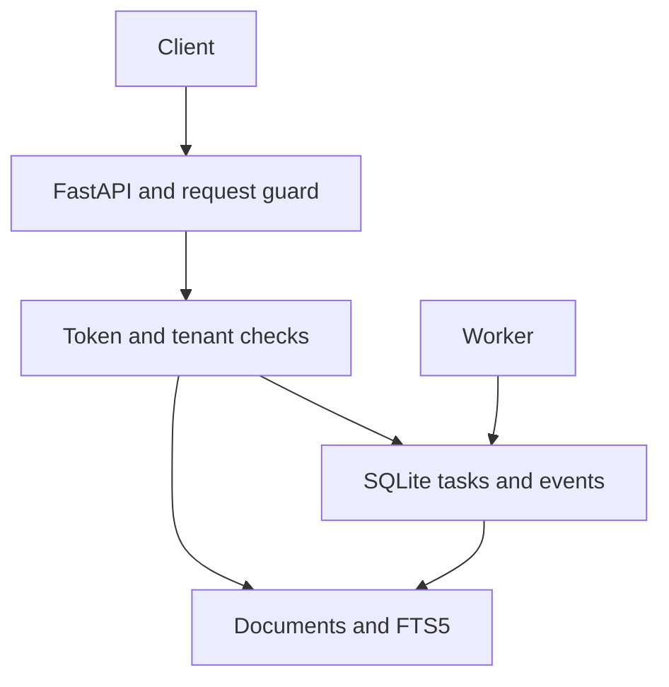
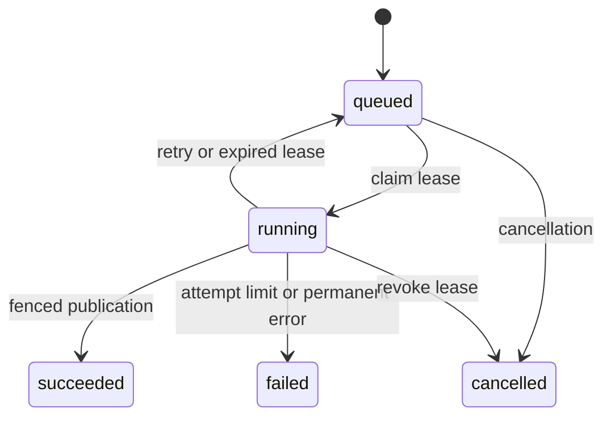

# 架构与不变量

当前业务：提交一份文本，在后台创建可检索的文档，返回属于调用方的原文片段。主要工程问题是任务状态、并发、身份边界和恢复。

HTTP 层校验输入和身份，Store 层用带租户条件的查询读资源。Worker 仅处理数据库中的任务；当前处理器是本地文本入库，没有外部工具副作用。

## 状态机

租约到期的最后一次尝试直接失败。取消会增加 token 并移除租约，旧 worker 即使继续执行，也不能提交文档。完成、失败是终态；取消同一任务可重复调用，但不能撤销已经完成的索引。

## 四个应能证明的不变量

1. **幂等命名空间。** `(tenant, idempotency_key)` 唯一；相同请求返回原任务，不同请求拒绝。请求内容经过确定的 JSON 序列化后存储与哈希。
2. **领取互斥。** `BEGIN IMMEDIATE` 写事务内选择并更新待运行任务；独立连接不会同时拿到同一任务的有效租约。
3. **提交有资格。** 发布事务取得写锁之后重新读取时间，检查任务、租户、running 状态、token 和期限。取消或失效的 token 无法写回。
4. **发布与索引原子。** 文档、FTS 内容、成功状态和事件在同一事务提交；FTS 写入失败时全部回滚。`documents.source_task` 还有唯一约束。

它们约束提交行为，不能保证处理代码只执行一次。未来若添加付款、发消息或外部工具调用，必须为那些副作用单独设计幂等、审批和恢复，不能沿用本地索引的保证。

续租在同样的写锁与资格检查下延长期限，保留 attempt 和 token，写入 `lease_renewed` 事件。独立心跳覆盖 Python 处理回调的运行时间；回调返回后停止心跳再提交，提交仍检查有效性。续租失败时不发布，取消和过期不会被续租逆转。每次处理预算独立使用单调时钟；到期时对有效 owner 记录 processing_timeout 并撤销 token，发布事务拿到写锁后再次查预算。协作上下文帮助回调退出，仍没有硬终止线程的保证。详见[预算教程](04-processing-budgets.md)。

## 持久化事件与 SSE

每次状态变化与事件一起写入数据库。事件有递增 ID；JSON 回放与 SSE 都先检查任务归属，再按游标读取。`Last-Event-ID` 超出 SQLite 整数范围时拒绝，不传入 SQL。终态事件读完后发出 `end` 并关闭流；长任务的连接最多持续 30 秒，之后可重连。

每轮 SSE 先读任务状态，再读事件页。由于终态与对应事件在同一事务提交，先观察到终态后读取事件才能安全决定关闭；反过来的读取顺序可能在两次查询之间发生终态提交时漏发最后一条事件。满 100 条的一页继续读取，直到终态下读到不满的一页。具体反例、修复理由和练习见 [SSE 终态事件](01-sse-terminal-events.md)。

事件保留策略、游标过期策略与大规模连接管理尚未实现。当前事件无限保留在数据库中，应在后续设计归档，而不是偷偷丢弃历史。

## 身份与数据边界

服务端配置 token 到租户 / 角色的映射，匹配时使用摘要和恒定时间比较。用户不能在文档请求中指定租户；额外字段拒绝。资源 ID 已知也不能访问别人的任务、文档、事件、流或检索结果。管理员统计单独要求 admin 角色，并只返回计数。

当前是静态运维配置，不是完整账号系统。token 配置不在数据库内管理。FTS 的行读取有租户过滤，但排序统计共享整个数据库，因此不声称强统计隔离。

## 取舍与故障

提交准入默认限制每租户 100、全局 1000 个 `queued` + `running` 任务；计数与新增任务共用写事务，超过上限返回 429。幂等重放不占新位置，等待重试仍占位置，终态释放。配置及真实 HTTP 例子见[队列容量](05-queue-capacity.md)。它不改变领取顺序，也不替代请求速率限制和历史数据保留策略。

| 选择 | 当前收益 | 当前限制 / 下一步 |
| --- | --- | --- |
| SQLite WAL | 低启动成本，可直接测试事务和崩溃恢复 | 同一主机，一个并发写事务；后续迁移 PostgreSQL |
| 内嵌轮询 worker | 一条命令就能演示完整流程 | 有准入容量上限；无任务公平调度，可另起 `worker` 进程 |
| Unicode61 FTS5 | 可复现的词法检索，来源可追踪 | 中文分词及语义有限；后续比较检索方案 |
| 期限 + token + 心跳 | 拒绝旧租约提交 | 使用持久化墙上时钟；活跃任务可续租，仍依赖合理系统时间与及时调度 |
| 每请求独立连接 | 线程之间不共享 SQLite connection | 写锁等待最长 5 秒；上层错误返回 503 |

测试用受控时钟验证租约边界，不靠随机睡眠碰运气。另有一个子进程取得租约后直接退出，再从同一数据库恢复。真实 HTTP 演示使用正常时钟验证整条业务链，不把这些结果当成生产可用性或吞吐认证。

源码入口：`api.py` 是 HTTP 协议与输入边界；`store.py` 是状态和事务；`worker.py` 是处理循环；`config.py` 是身份配置。读代码时先追踪一次正常请求，再追踪取消、超时、回滚与重复提交。
